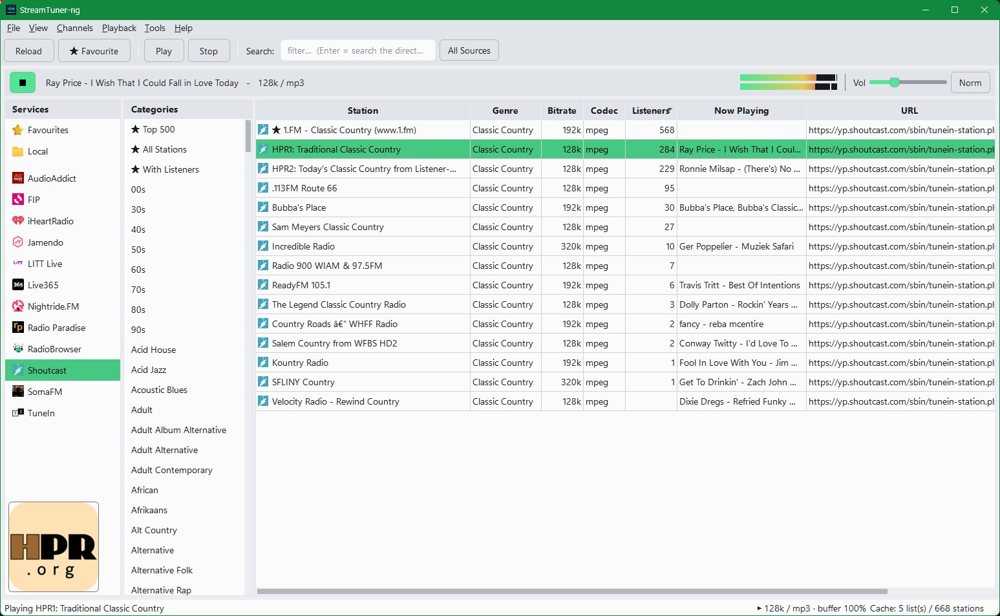
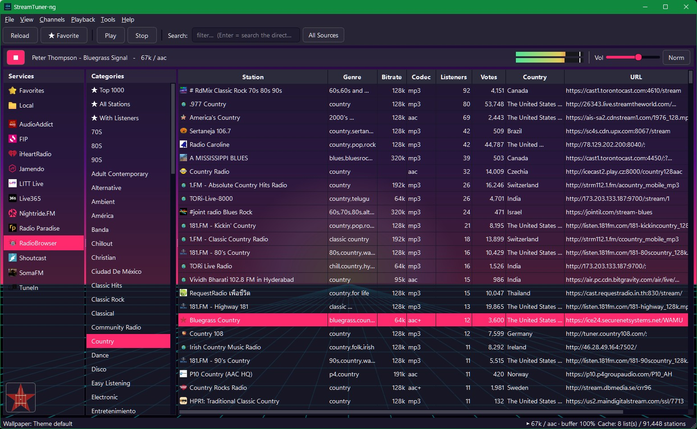

  

<table>
  <thead>
    <tr>
      <th align="center" width="50%">Normal</th>
      <th align="center" width="50%">Theme</th>
    </tr>
  </thead>
  <tbody>
    <tr>
      <td align="center">
        
      </td>
      <td align="center">
        
      </td>
    </tr>
  </tbody>
</table>

# StreamTuner-NG

A cross-platform internet-radio browser inspired by StreamTuner2, built with PySide6 (Qt 6) and libmpv audio.

Browse by genre, search supported directories, and save your favorite stations. Customize the look with themes, color palettes, and wallpapers, or add your own Python providers.

## Features

Browse the built-in directories alongside your **Favorites** and **Local** station lists:

| Service | Free listening | Go to their site for Premium Services |
| :-- | :--: | :-- |
| **FIP** | ✅ Yes | Public radio, free for listeners |
| **iHeartRadio** | ✅ Yes | Optional ad-free listening and on-demand features |
| **Jamendo** | ✅ Yes | Free music catalog |
| **LITT** | ✅ Yes | Optional ad-free listening |
| **Live365** | ✅ Yes | Free station listening; paid plans for broadcasters |
| **Nightride.FM** | ✅ Yes | Support through Patreon and merchandise |
| **Radio Paradise** | ✅ Yes | Listener-supported radio, including FLAC streams |
| **RadioBrowser** | ✅ Yes | Open community radio directory |
| **SHOUTcast** | ✅ Yes | Radio directory; paid hosting for broadcasters |
| **SomaFM** | ✅ Yes | Commercial-free radio funded by donations |
| **TuneIn** | ✅ Yes | Premium music, news, sports, and audiobooks |

Visit each provider’s website for its premium offerings. Use the provider’s app for subscription features.

> 💛 **Support the stations you enjoy.** Subscribe or donate directly to help sustain their programming.

Playback, browsing, and customization features include:

- **Search scopes**: Choose **Loaded list** to filter as you type, or **This source** / **All sources** to search supported catalogs with **Enter** or **Search**. Results arrive progressively, with a clear way back to your category.
- **Favorites & history**: Save stations, export favorites and station history as CSV, or import CSV into Favorites. Use JSON backups to restore settings and saved lists.
- **Twenty classic themes + your own**: Dark, Light, Dracula, Nord, Solarized (light and dark), Gruvbox (dark and light), Tokyo Night, Monokai Pro, Dark Pastels, Cyberpunk Neon, Ubuntu, xterm, Amber, Green Phosphor, White Phosphor, CGA, CRT, and Synthwave. Import or export custom JSON themes with the [theme guide](THEME-HOWTO.md).
- **Wallpapers**: Choose the Synthwave grid, either Vaporwave background, or your own image under **Options → Themes → Wallpaper**. Adjust the dim slider to keep station lists readable.
- **Colors**: Choose from 47 BS-Notepad palettes under **View → Colors**. Hover to preview a color card; click to apply and save. Your current theme stays unchanged until you click.
- **Python plugins**: Drop a `.py` provider into the adjacent `plugins/` folder and restart. Start with `_example.py` and the [plugin guide](PLUGINS.md). Plugins can declare their own right-click options without additional UI code.
- **Visualizers**: Choose a stereo VU meter or a scrolling visualization driven by audio levels in the player bar.
- **Desktop integration**: Use the tray and notifications where your desktop supports them. Optional Discord Rich Presence is off by default. Loudness normalization and keyboard shortcuts are included; global media keys are supported on Windows.
- **Cached browsing**: Disk caching speeds up repeat visits, while background refreshes update station lists. Use **Reload** or **F5** to request fresh results.

## Make it yours

Personalize the app and manage your saved data from these controls:

| Setting | Where to find it |
| :-- | :-- |
| **Themes** | **Options → Themes**: select a theme, choose a wallpaper, or import/export a custom theme |
| **Colors** | **View → Colors**: hover to preview a palette, then click to apply |
| **Plugins** | **Tools → Open Plugins Folder**: copy `_example.py` to a new filename, edit it, and restart |
| **Local stations** | **Add station…** on the toolbar or **Ctrl+N**: save a named stream or paste several URLs, one per line; find them under **Local → My Stations** |
| **Backup & cache** | **Options → Cache & Data**: manage caches, choose station-icon storage, and export/import settings and saved lists |
| **Your data** | Linux/macOS: `~/.config/streamtuner-ng/`, or your configured XDG location. Windows: `%APPDATA%\streamtuner-ng\` |

## Why it's solid

Directory requests use timeouts and exception guards. The app disables repeatedly failing providers independently and keeps previously cached station lists available.

These guards handle ordinary request failures. Plugins run inside the application with your account’s permissions, so install code only from authors you trust.

## Heritage & credits

StreamTuner-NG carries forward the idea of **StreamTuner2** — browse internet-radio directories
as pluggable "channels" — but it is a complete, ground-up rebuild in modern Python/Qt, not a
copy of the original (GTK, Public Domain) code. **Ported & reimagined by IronWolve.**
See **[NOTICE](NOTICE)** for license and attribution notes.

- Audio — **libmpv** (LGPL)
- UI — **Qt 6 / PySide6** (LGPL)
- Stations — RadioBrowser, SomaFM, Shoutcast, TuneIn, and the other directories listed above —
  **please support the ones you love** (subscribe or donate)

Project code is licensed under **Apache-2.0** — see [LICENSE](LICENSE) and [NOTICE](NOTICE).
Source: <https://github.com/IronWolve/StreamTuner-ng>
